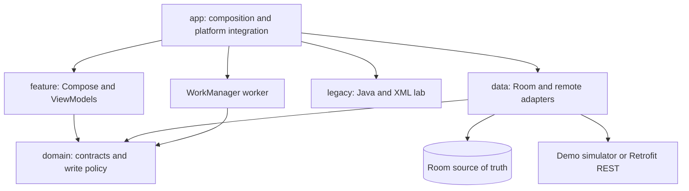

# Design and reasoning

Field Notes is a small fieldwork journal with a deliberately substantial correctness boundary: an observation must remain available offline, an ambiguous network response must not duplicate a write, and synchronization must never erase a newer local edit. The application is organized so those rules can be studied and tested independently from screen rendering.

## Boundaries and dependencies

`domain` has no Android dependency. `feature` knows contracts and domain values, not Retrofit DTOs, DAO entities, or token storage. `data` implements the contracts and translates between representations. `app` selects the environment and composes dependencies through Koin. Constructor injection makes the same classes usable with fakes; the worker uses an explicit factory rather than finding services itself.

This is MVVM with a unidirectional state cycle: the UI sends actions, the ViewModel coordinates domain/repository calls, and observed data produces immutable UI state. These properties overlap with MVI, but there is no second parallel architecture or mandatory reducer abstraction. Clean Architecture is represented by dependency direction and business-policy separation, not an interface for every single method. The repository, remote, clock, ID generator, scheduler, preferences, telemetry, and session boundaries have actual replaceable consumers or tests.

## Read and write paths

All journal reads come from Room flows. The ViewModels use `StateFlow` and lifecycle-aware Compose collection. `WhileSubscribed` stops observation when consumers leave. Search displays text immediately and debounces matching across note bodies. The editor binds state-based text fields directly to its draft buffers and takes a text snapshot when saving. `SavedStateHandle` restores the search query, project selection, draft buffers, and the draft's expected revision after ordinary recreation. Press Save to persist a draft in Room.

Preferences read directly from DataStore. Only a missing installation ID triggers an initialization update. Preferences emit safe defaults during a storage I/O failure, then retry with capped backoff so active collectors receive persisted settings when storage recovers. The editor retains its draft across failed loads, and the detail screen gives read errors a retry action distinct from the missing-note state.

`SaveNote` trims and validates title/body/project, asks the repository to commit locally, then requests background synchronization and records a content-free event. The repository validates again at its write boundary so an import or another client cannot bypass the policy. A transaction checks the edit's expected local revision and writes the note with its outbox snapshot. The screen can show the committed value immediately, including offline. A scheduling error after a committed save, delete, or conflict resolution leaves the successful local change intact. Startup and periodic work can pick it up later.

Projects and notes form a foreign-key relationship. The outbox keeps each note's mutations in sequence and gives each operation a unique ID. The version-1-to-2 migration adds the note ordering index. Version 3 adds a sync-state index and a drain cursor, and clears obsolete demo receipts while keeping pending mutations and their receipts. The exported Room schemas and migration tests document the supported upgrade path.

## Synchronization invariants

1. An editor keeps the local revision it loaded, including when Android restores its draft. If the stored revision changes or the note is deleted before Save, the transaction rejects the stale edit and the editor keeps the draft. Each accepted local edit creates an immutable queued mutation with a unique operation ID.
2. A retry after an unknown outcome sends the same operation ID and logical payload. The server transaction stores both the change and the successful acknowledgment, so replay returns the original result.
3. Local revision and server version are separate. An acknowledgment for revision N must not overwrite an edit made at revision N+1 during the network request.
4. Only after an operation is acknowledged can its queued successors be rebased on the returned server version. Do not rewrite an uncertain in-flight operation to “make it current.”
5. A stale server version produces a conflict containing the remote value. Keep the local copy and require an explicit keep-local or use-server decision.
6. Deletion is a queued tombstone. Conflicted and rejected deletions stay visible for recovery.
7. A definitive, operation-scoped rejection marks that note's chain as paused. Editing or explicitly retrying the rejected note creates a fresh mutation from its latest local content. An ambiguous mutation response defers that note and its successors for the current pass, keeping the exact payload for replay. Unrelated notes and the snapshot can still sync.
8. Pulling a snapshot must preserve pending, conflicted, and rejected local work. A note with an unrecognized sync state or an unusable conflict copy offers two recovery actions. Saving as new preserves the local text in a separate note. Explicitly discarding the local copy removes that note's queued changes and preserves its revision so an older draft cannot overwrite a server copy restored by a later pull. The discard is local and sends no server deletion. Room stays authoritative for the UI.
9. Coroutine cancellation is propagated. It is never converted into successful synchronization or a user-facing generic failure.

The repository serializes synchronization with a mutex while allowing local edits during network I/O. Each call defaults to two minutes including time spent waiting for the mutex. A pass takes an outbox watermark, attempts up to 128 mutations, and stops starting uploads early to reserve time for the last request and pull. It pulls on the first, final, and ambiguous passes, with at most two skipped pulls while draining a healthy backlog. Snapshot merges use bounded database batches. Database transactions do not span HTTP calls. The demo adapter keeps replay receipts in the same database until the associated pending upload is acknowledged or discarded. Its cleanup participates in the outbox transaction. The Python server uses its own SQLite database for the HTTP path. See [API](docs/API.md) for request and failure semantics.

## Platform work and resource use

WorkManager persists one coalesced wakeup for a burst of edits, and the hourly refresh uses the same wakeup logic. The wakeup enqueues a unique drain with `KEEP`. If a drain is already running, the wakeup observes its state so it can hand off the edit as soon as the current attempt ends. A wait that times out uses the bounded retry policy. This handoff covers writes that land after a drain has checked the outbox. The drain uses a connected-network constraint for local HTTP and a battery constraint for both flavors. A bounded pass with more eligible operations requests another wakeup before it finishes. Terminal failures appear in the journal. Foreground sync gives up waiting after its own deadline and requests a background continuation.

There is intentionally no always-running service. A foreground service would need a user-visible long-running task, a declared service type, a notification, and current platform restrictions. Adding one merely to keep this journal alive would teach the wrong execution model.

Compose uses stable note keys, lazy collections, bounded content widths, a navigation rail at wider sizes, and a bottom navigation bar on compact windows. Labels, headings, meaningful icons, non-color status text, Material touch targets, system font scaling, and dark theme are part of the UI implementation. Automated tests do not substitute for TalkBack, large-font, switch-access, tablet, foldable, RTL, and keyboard review.

## Interface design

The visual language uses forest green for primary actions, paper-like light surfaces, and warm gold selection containers. Every Material color role has an explicit foreground/background pair in light and dark mode; fixed roles are shared intentionally. Error text and conflict surfaces use the error palette. Status also has a label and icon, so color is never the only signal.

Serif headings give the journal its character; body text and controls use the platform sans-serif family. Typography is defined once in `Theme.kt`, with readable line heights and scalable `sp` sizes. Shared page and group spacing uses 8, 16, 24, and 32 dp. Journal cards keep their existing internal spacing. The journal grid is bounded to 1120 dp, and reading/forms to 680 dp, while compact windows use the available width and scroll vertically.

An empty journal offers one prominent **New note** button near the top. A populated journal uses a smaller heading, a wrapping count/sync summary, and the floating creation action. Search and project filters remain available when a filter returns no matches. Pending deletion counts remain visible even when there are no notes left; loading and failure states do not present a misleading first-note invitation.

Settings groups everyday controls under short headings. Each preference row is one accessible switch action with a minimum 48 dp target. Experiment assignment and reset controls sit behind **About the layout experiment**, whose expanded/collapsed state is exposed to accessibility services. Demo mode explains local-only sync; server credentials appear only in the local flavor. Action labels describe what happens, including saving a token without implying that the server has accepted it.

These choices apply the hierarchy, typography, wording, and consistency guidance from [Impeccable](https://impeccable.style/) to native Material 3 components. No web-specific scanner or design plugin is required. Rendered review covers representative themes and font/window sizes; method tests remain focused on behavior. See [verification](verification/RESULTS.md) for the executed scope and remaining accessibility work.

## Security and observability

The local server token is an opaque bearer credential. The UI does not own decryption or HTTP headers. A dedicated token store encrypts it with AES-GCM using a non-exportable Android Keystore key and an atomic file under the no-backup directory. A missing key, malformed record, or ciphertext-authentication failure clears unusable credential material and requires re-entry. An HTTP authentication rejection is a separate synchronization outcome. Credential processing is dispatched off the main thread. The app disables backup and declares explicit device-transfer exclusions on Android 12 and later. It restricts exported components and limits the HTTP exception to the local development build/host.

Room notebook contents are app-private but not separately encrypted. Sign-out removes the credential, not the notebook. The sample has no user-switching model and cannot claim account isolation. [Production](docs/PRODUCTION.md) lists the changes required before using sensitive or multi-user data.

Diagnostics are opt-in and local. The telemetry interface accepts typed events, not arbitrary strings containing note text or tokens. Local counters and crash exception type demonstrate instrumentation and consent. The compact-card experiment allocates installations to control/compact arms using a versioned SHA-256 hash of a randomly generated local installation ID persisted in DataStore. The ID is not transmitted or logged. A user can explicitly override the assigned layout and reset the override; overridden observations are excluded from arm-level metrics. Consent-gated local exposure and note-save counters demonstrate the measurement boundary. There is no configured Crashlytics/Sentry service, remote alerting, remote experiment rollout, or evidence of improved product outcomes.

Applying a preference snapshot advances an in-memory revision under the diagnostics lock. If that revision changes while an event reads preferences, the diagnostics sink drops the event. This prevents an older read from restoring consent after an observed opt-out has cleared the counters. Diagnostic setup failures are logged independently of sync scheduling.

## Testing boundaries

Routine tests call domain, ViewModel, adapter, preference, telemetry, and worker-policy methods and assert returned values, state, and collaborator effects. Constructor fakes and coroutine test dispatchers keep business behavior independent of screen rendering. MockWebServer and DataStore tests exercise real HTTP/file boundaries on the JVM, while Robolectric supplies Android behavior for local telemetry tests; these are not all pure isolated unit tests.

Functional UI automation is outside the chosen test scope. Optional non-UI device tests cover Room transactions/migration, permission gating, Keystore, and WorkManager. The local server and Android-to-server integration suites are manual checks, and benchmark/profile sources are manual performance exercises. Routine CI runs JVM method tests, lint, builds, and documentation validation without starting an emulator or Python server. Screen layout, navigation, and accessibility are reviewed manually.

## Tradeoffs to study

- Full snapshots and in-memory search simplify inspection. A large corpus needs incremental sync, pagination, bounded loading, and measured database search, not an unsubstantiated claim of scale.
- A durable outbox uses more storage than a single dirty bit but handles a server commit followed by a lost response correctly.
- Local simulator tables make the demo restart-safe while avoiding a hidden cloud dependency. They are not an independent backup.
- Koin keeps composition concise and constructor tests straightforward. Hilt/Dagger offer compile-time graph generation; see the requirements map for alternatives.
- Java/XML exists as a contained interoperability lab. New journal screens use Compose rather than maintaining duplicate UI implementations.
- Library publishing and baseline-profile generators are supplied as study tooling. Public package publishing, device timing, signed distribution, and service operations require separate executed work and evidence.
