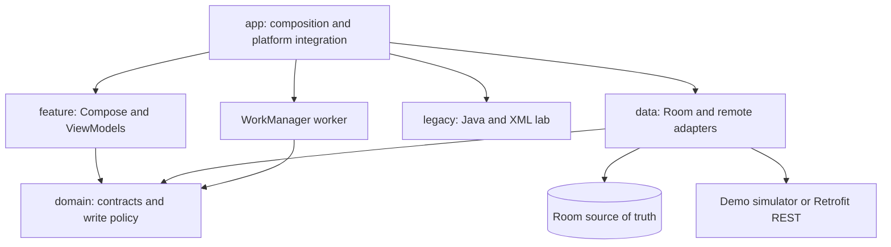

# Design and reasoning

Field Notes is a small fieldwork journal with a deliberately substantial correctness boundary: an observation must remain available offline, an ambiguous network response must not duplicate a write, and synchronization must never erase a newer local edit. The application is organized so those rules can be studied and tested independently from screen rendering.

## Boundaries and dependencies

`domain` has no Android dependency. `feature` knows contracts and domain values, not Retrofit DTOs, DAO entities, or token storage. `data` implements the contracts and translates between representations. `app` selects the environment and composes dependencies through Koin. Constructor injection makes the same classes usable with fakes; the worker uses an explicit factory rather than finding services itself.

This is MVVM with a unidirectional state cycle: the UI sends actions, the ViewModel coordinates domain/repository calls, and observed data produces immutable UI state. These properties overlap with MVI, but there is no second parallel architecture or mandatory reducer abstraction. Clean Architecture is represented by dependency direction and business-policy separation, not an interface for every single method. The repository, remote, clock, ID generator, scheduler, preferences, telemetry, and session boundaries have actual replaceable consumers or tests.

## Read and write paths

All journal reads come from Room flows. A network response does not become a second UI source of truth. The ViewModels use `StateFlow` and lifecycle-aware Compose collection; `WhileSubscribed` stops unnecessary observation when consumers leave. Search and project selection, and an unfinished editor draft, use `SavedStateHandle`. Saved state supports ordinary Android recreation/process restoration; it is not a durable replacement for pressing Save, and Android does not promise restoration after force-stop or clearing app data.

`SaveNote` trims and validates title/body/project, asks the repository to commit locally, then requests background synchronization and records a content-free event. The repository validates again at its write boundary so an import or another client cannot bypass the policy. A transaction writes the note and its immutable outbox snapshot together. The screen can therefore immediately show the committed local value even when no network is available.

Projects and notes form a foreign-key relationship. Outbox sequence determines upload ordering; operation IDs are unique. The version-1-to-2 migration adds the note ordering index and preserves existing notes and queued mutations. Exported Room schemas and a migration test make that contract reviewable. There is no destructive-migration fallback.

## Synchronization invariants

1. Each distinct local edit creates an immutable queued mutation with a unique operation ID.
2. A retry after an unknown outcome sends the same operation ID and logical payload. The server transaction stores both the change and the successful acknowledgment, so replay returns the original result.
3. Local revision and server version are separate. An acknowledgment for revision N must not overwrite an edit made at revision N+1 during the network request.
4. Only after an operation is acknowledged can its queued successors be rebased on the returned server version. Do not rewrite an uncertain in-flight operation to “make it current.”
5. A stale server version produces a conflict containing the remote value. Keep the local copy and require an explicit keep-local or use-server decision.
6. Deletion is a queued tombstone. A deletion conflict remains discoverable until it is resolved.
7. Pulling a snapshot must not overwrite pending/conflicted local work. Room stays authoritative for the UI.
8. Coroutine cancellation is propagated. It is never converted into successful synchronization or a user-facing generic failure.

The repository serializes synchronization with a mutex while allowing local edits during network I/O. Database transactions are short and do not span HTTP calls. The demo remote implements the same protocol with separate persistent tables; the [Python server](server/fieldnotes_server.py) uses SQLite transactions for the real HTTP path. See [API](docs/API.md) for exact request and failure semantics.

## Platform work and resource use

WorkManager is appropriate for deferrable synchronization and handles process restart, constraints, and scheduling through Android platform services. The worker requests a connected network for the local HTTP flavor and avoids low-battery execution. The demo has no network constraint. A named periodic request supplies eventual recovery; named one-shot requests use append-or-replace semantics to avoid losing an edit that arrives just as another worker finishes. Transient failures use exponential backoff with a bounded retry policy; authentication, denied local-network permission, and rejected requests wait for corrective action.

There is intentionally no always-running service. A foreground service would need a user-visible long-running task, a declared service type, a notification, and current platform restrictions. Adding one merely to keep this journal alive would teach the wrong execution model.

Compose uses stable note keys, lazy collections, bounded content widths, a navigation rail at wider sizes, and a bottom navigation bar on compact windows. Labels, headings, meaningful icons, non-color status text, Material touch targets, system font scaling, and dark theme are part of the UI implementation. Automated tests do not substitute for TalkBack, large-font, switch-access, tablet, foldable, RTL, and keyboard review.

## Security and observability

The local server token is an opaque bearer credential. The UI does not own decryption or HTTP headers. A dedicated token store encrypts it with AES-GCM using a non-exportable Android Keystore key and an atomic file under the no-backup directory. A missing key, malformed record, or ciphertext-authentication failure clears unusable credential material and requires re-entry. An HTTP authentication rejection is a separate synchronization outcome. Credential processing is dispatched off the main thread. The app disables backup, restricts exported components, and limits the HTTP exception to the local development build/host.

Room notebook contents are app-private but not separately encrypted. Sign-out removes the credential, not the notebook. The sample has no user-switching model and cannot claim account isolation. [Production](docs/PRODUCTION.md) lists the changes required before using sensitive or multi-user data.

Diagnostics are opt-in and local. The telemetry interface accepts typed events, not arbitrary strings containing note text or tokens. Local counters and crash exception type demonstrate instrumentation and consent. The compact-card experiment allocates installations to control/compact arms using a versioned SHA-256 hash of a randomly generated local installation ID persisted in DataStore. The ID is not transmitted or logged. A user can explicitly override the assigned layout and reset the override; overridden observations are excluded from arm-level metrics. Consent-gated local exposure and note-save counters demonstrate the measurement boundary. There is no configured Crashlytics/Sentry service, remote alerting, remote experiment rollout, or evidence of improved product outcomes.

## Testing boundaries

Routine tests call domain, ViewModel, adapter, preference, telemetry, and worker-policy methods and assert returned values, state, and collaborator effects. Constructor fakes and coroutine test dispatchers keep business behavior independent of screen rendering. MockWebServer and DataStore tests exercise real HTTP/file boundaries on the JVM, while Robolectric supplies Android behavior for local telemetry tests; these are not all pure isolated unit tests.

Functional UI automation is outside the chosen test scope. Optional non-UI device tests cover Room transactions/migration, permission gating, Keystore, and WorkManager. The local server and Android-to-server integration suites are manual checks, and benchmark/profile sources are manual performance exercises. Routine CI runs JVM method tests, lint, builds, and documentation validation without starting an emulator or Python server. Screen layout, navigation, and accessibility are reviewed manually.

## Tradeoffs to study

- Full snapshots and in-memory search simplify inspection. A large corpus needs incremental sync, pagination, bounded loading, and measured database search, not an unsubstantiated claim of scale.
- A durable outbox uses more storage than a single dirty bit but handles a server commit followed by a lost response correctly.
- Local simulator tables make the demo restart-safe while avoiding a hidden cloud dependency. They are not an independent backup.
- Koin keeps composition concise and constructor tests straightforward. Hilt/Dagger offer compile-time graph generation; see the requirements map for alternatives.
- Java/XML exists as a contained interoperability lab. New journal screens use Compose rather than maintaining duplicate UI implementations.
- Library publishing and baseline-profile generators are supplied as study tooling. Public package publishing, device timing, signed distribution, and service operations require separate executed work and evidence.
